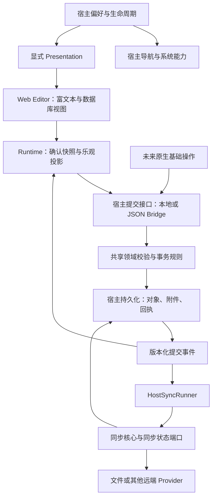

# 架构复核（2026-10-23）

本轮从原始产品需求出发的全项目审查见 [产品与架构健康审查](architecture-review-2026-10-23.md)，包含新发现的复现用例与共享文件分片设计。以下内容保留为上一轮历史记录。

> 本文保留重构前的问题与证据。当前实现见 [架构说明](architecture.md) 和 [验证记录](verification.md)。
> 本轮整改已替换连接/空间模型、主题所有权与 CSS 边界、字段命令/撤销、提交回执与事件、附件提升、宿主同步运行器、异步关闭及 Registry 版本判断；协议改用真实 JSON 契约验证。新增空间级/字段级权限端口与拒绝发布的草稿处理。历史数据不迁移，不提供旧格式入口。

本次针对当前源码审查宿主/编辑器边界、主题、状态流、持久化、同步和扩展协议。仅新增审计文档，没有修改业务实现。主题及下面注明的两个命令问题使用独立无头 Chrome 会话验证；其余为源码审查结论或明确标注的风险。本次没有重新执行完整测试套件。

结论：现状完成了编辑区域打包与第一层存储接口抽取，但尚未完成要求的架构解耦。不能把“编辑器可独立加载”“没有直接 import IndexedDB”当作宿主权责、并发状态和跨平台契约都已完成。之前对重构完成度的判断过于乐观。

## 1. 主题：已复现的全局样式污染（高优先级）

进入离线工作空间后：

| 状态 | html class | body 背景        | 侧栏背景         | 编辑器背景       |
| ---- | ---------- | ---------------- | ---------------- | ---------------- |
| 深色 | dark       | rgb(255,255,255) | rgb(247,247,245) | rgb(25,25,25)    |
| 浅色 | 空         | rgb(255,255,255) | rgb(247,247,245) | rgb(255,255,255) |

宿主的 class 切换正常；失败的是 CSS 变量级联。实际 CSSOM 中：

- `apps/web/src/styles/tailwind.css` 的默认 `:root,:host` 位于 `@layer theme`。
- 同文件的 `.dark` 在层外，设置深色变量。
- 后加载的 `packages/web-editor/src/style.css` 生成了**层外** `:root,:host`，重新设置浅色变量。
- `:root` 与 `.dark` 同等优先级，后者被后加载的编辑器全局规则覆盖。
- 编辑器自身 `.tio-editor.dark` 又设了局部变量，所以编辑区域仍正常变化。

编辑器导出样式并没有做到完全局部隔离。除主题外，utilities 和第三方 `.bn-*` 规则也有全局输出，需要审查编译产物，而不只是查看源码是否有 `.tio-editor`。

相关文件：`packages/web-editor/src/style.css:1`、`apps/web/src/styles/tailwind.css:44`。

## 2. 展示状态所有权倒置（高优先级）

`packages/ui/src/theme.tsx` 持有 module singleton、订阅器和修改函数；`ThemeSwitcher` 直接改 singleton。`apps/web/src/services/browser-presentation.ts` 只是监听 UI 包，再写 HTML 和 localStorage。

`packages/web-editor/src/index.tsx:48` 允许 presentation 缺省，并回退到共享 UI/i18n 状态；Web 页面实际没有传 presentation。独立 mount 却使用显式 presentation，形成两套行为。`useTheme` 从局部 Context 读取，但 `ThemeSwitcher` 向全局状态写入，组合使用时读写源也不同。

应由宿主拥有 theme/locale/preference；按钮只是受控输入；编辑器必须接收已解析的 presentation，不读取全局偏好、不修改宿主样式。平台存储偏好是合理的平台职责，UI 包持有应用级真值则不合理。

## 3. CAS 不等于语义并发安全（高优先级）

`packages/workspace/src/commands.ts:60` 的 editFields 在最新快照上仍整包覆盖 fields。验证：最新数据库字段是 A、B，旧客户端提交仅包含重命名 A 的字段列表，重放后 B 消失。

CAS 能避免旧版本直接写入，却不能阻止“重试时把旧意图作为完整列表覆盖”。新增、删除、改名、重排字段应该是显式命令，按字段 ID 及前置条件重放，不能依赖调用方始终拿到最新整个数组。数据库视图和记录值还需要定义字段变更的事务规则。

另一个已验证问题：删除后撤销时 inverse 恢复原对象，原对象通常没有 deleted 属性；`core/src/commit.ts` 只放行 `deleted === false`，结果拒绝提交并报告 Immutable identity or unsupported format。前端命令与宿主验证未共享一致的领域规则。

`workspace/src/basic.ts` 对 createRecord 的字段检查发生在初始快照上，之后冲突重试通过 createObjects 重放，并不再次检查最新数据库字段。当前契约还不足以让原生操作与编辑器操作安全共享规则。

## 4. 状态通知缺少因果关系（中高优先级）

Repository 的 changed 只是无参数通知；没有 version、commitId、origin 或 changedIds。Runtime refresh 丢弃 workspace version，仅按对象 revision 合并，然后重放全部 pending；commit 回执由另一条路径消费。

风险：自身 commit 通知先于回执被处理时，已经提交的命令仍可能在投影中重放。当前部分 reducer 是幂等的，但契约没有保证，也无法可靠识别哪些 pending 已包含在快照里。这里是时序风险，尚未单独构造端到端失败。

建议固定流程：宿主事务 → 带版本及提交身份的事件 → Runtime 原子更新 baseline 并消除已确认 pending → 重放剩余命令。通知丢失用版本游标重读恢复。业务真值在宿主；Runtime 只有确认快照与乐观投影；React 保留光标、选择、弹窗等交互状态。

当前普通输入已移除旧 DraftInput 镜像，这一点有效，不应再把所有组件局部状态都误判为耦合。BlockNote 的编辑状态仍应保留，但接入协议需要定义回声与外部更新关系。

## 5. 提交回执永久保存完整空间（高优先级）

`packages/local-store/src/index.ts:107-135` 每次读取全部对象，applyCommit 返回全部 entries，再把完整 result 和请求 signature 永久保存到 settings 的 `$commit/<id>`。

Runtime 每个编辑命令都提交一次；没有回执回收协议。每次改一个标题，也会留下一份整个空间的历史副本，空间开销近似“提交次数 × 工作空间大小”。跨桥回包同样返回全量 entries。幂等回执是必要的，回执永久携带完整空间不是必要条件。

应改为紧凑 commit receipt、变更 entries/版本游标，并设计明确的确认水位或过期恢复协议；不能简单按时间删除后仍承诺无限期重试幂等。读取接口可以保留初始全量快照，但增量刷新及对象查询必须有扩展位置。

## 6. 存储拆开了调用接口，职责仍混装（中优先级）

LocalStore 同时管理业务对象、二进制、暂存、回执、同步基线、恢复记录、空间目录、偏好、文件夹句柄。Session 类型也定义在 IndexedDB 包内，Web controller 导入该类型。

Web composition 直接创建 LocalStore 本身合理；问题是可复用的空间描述、同步元数据和提交契约没有清楚拆开，其他宿主需要从 IndexedDB 实现里反推规则。

建议按职责定义 WorkspaceRepository、AssetStore、SyncStateStore、WorkspaceCatalog、HostPreferences，由宿主实现并组合。可以共用一个数据库和跨 store 事务，不必为了接口拆分而拆成多个物理数据库。文件夹句柄应只存在 Web adapter 配置中。

## 7. 附件暂存/提交边界不闭合（高优先级）

`local-store/src/index.ts:155` 的 readAsset 在已提交数据不存在时返回暂存数据；`sync/src/index.ts:156-179` 下载缺失附件后 stageAsset，但只有元数据变化才 reconcile/commit。因此“元数据已存在、二进制缺失”的修复会停在暂存状态。暂存清理一旦加入就可能使已引用附件重新丢失。

公开 putBlob 还保留绕过事务提升的入口。应区分已提交读与指定暂存引用读，以原子事务提升二进制及元数据；无元数据变化的二进制修复也需要明确提交路径，并测试清理后的可读性。

桥接 stageAsset 在 timeout 的 finally 中立即 release 传输引用，但超时不代表宿主停止读取；慢宿主可能仍在使用该引用。反方向响应丢失则可能遗留 transfer。需要 ACK/租约/取消及回收语义，不能仅依赖 Promise finally。

## 8. 同步仍依附编辑会话（高优先级）

`apps/web/src/services/workspace-services.ts:84-89` 用 Runtime saved 决定同步是否 ready，使用 Runtime.onEdit/onPersisted 启动尾沿 debounce。原生快捷指令、其他窗口、未来后台任务直接提交到仓库，不经过这个 Runtime，就没有同样的同步触发路径；当前可能依靠轮询迟到发现，并非完全无法同步。

连续编辑的 1 秒尾沿合并已经存在，应保留。但正确触发源应是宿主成功提交事件，所有写入来源一致。可另加编辑活跃信号延后传输，不能要求编辑器存在才能启动同步。

`packages/sync/src/index.ts` 同时拥有 merge/reconcile、定时器、重试、前后台策略和中文“文件夹”状态文案。DOM/锁已注入是进步，但同步策略和平台运行器并未充分拆开。

建议 SyncPlanner/单次执行核心复用数据合并及事务规则；HostSyncRunner 拥有 debounce、clock、前后台、重试、锁和终止生命周期。输出结构化状态及问题码，由宿主翻译。远端普通文件系统不支持 CAS 的限制应继续明确，不承诺跨设备强一致。

## 9. 生命周期和双入口行为未统一（中优先级）

- Web 直接向 EditorSurface 传 Runtime，独立编辑器自己创建 Runtime，两者应基于同一 session/application 接口与契约测试。
- mountEditor 的 onReady 在 root.render 后立即调用，并不表示 DOM 与编辑器已就绪。
- open 在 await flush 后没有重新检查关闭状态，存在与 dispose 竞争的窗口。
- WorkspaceServices.dispose 直接 release；Runtime 有 pending 时会拒绝 dispose，清理流程没有异步关闭/失败恢复协议。
- SyncEngine.stop 会标记停止，并在对象循环边界检查，但不会等待当前 I/O；会话关闭不能因此被当作“所有宿主操作均已完成”。
- LocalStore.close 只关闭通知，不关闭该实例打开的 IDB 连接。

宿主应定义 opening/ready/flushing/closing/closed/error 生命周期，明确未确认写入如何处理。不能无条件丢弃 pending，也不能让卸载清理异常留下资源。

## 10. 向后兼容有保留策略，升级路径仍不完整（中高优先级）

未知字段、opaque block 和未来对象只读保留值得继续使用。但 schemaVersion===1 散落在 core editable、sync 和校验中；Registry 不统一驱动这些能力。applyCommit 又禁止已有对象改变 schemaVersion，没有独立授权迁移事务。

因此现在有“不要破坏未知内容”的保护，却没有完整的“新增类型/升级版本可以小范围接入”的机制。需要统一 registry 的读、写、迁移能力，区分业务 commit 与迁移 commit，并给新类型/字段能力提供 fixtures。不能以存在 Registry 类就认定后续扩展不需跨层改造。

## 11. 协议与验证覆盖不足（中优先级）

host-protocol 的 envelope/payload 多处 any，缺少请求和响应的运行时 schema；loopback 使用 structuredClone，而不是真正 JSON 编解码，不能证明跨语言宿主会产生等价行为。基础协议有 session/workspace 校验、握手、请求 ID、超时和 capability，这些应保留。

现有边界脚本主要扫描 package.json 和 src 顶层文件的关键字，不验证传递依赖、CSS 全局副作用或任意子目录代码。现有主题测试检查 html class，正好漏掉本次真实故障。

需要增加：真实 JSON 传输契约、乱序/重复/丢失事件、超时后查询、附件租约、没有编辑器时的宿主写入及同步、双方并发字段变更、删除撤销、宿主与编辑器计算样式、双编辑器及卸载后隔离、v1/未来格式往返和迁移路径。

## 建议实施顺序与边界

1. 修复主题 CSS 外泄，同时把 presentation 收归宿主，Web 和独立 mount 都使用显式输入。验证侧栏/顶栏/编辑器 computed style，不能只验证 class。
2. 定义可序列化领域命令与宿主事务验证；先修字段覆盖、撤销及 basic command 重放问题，再统一两个编辑入口。保留现有富文本及数据库视图，不重写编辑器。
3. 完善 commit receipt、版本化事件、增量读取和附件事务；按职责拆端口但保留现有 IndexedDB 数据兼容。
4. 把同步调度迁到 HostSyncRunner，由所有已提交变更驱动，并完成异步会话关闭。
5. 补齐 JSON protocol、registry 迁移路径和跨实现契约测试，再更新“架构已完成”的文档结论。

目标流向：

无需本次实现原生日历、小组件或任何新平台；需要的是在 Web 中先验证它们未来会依赖的宿主契约。包数量并不是完成标准，权责明确、所有写入来源一致、状态因果可验证、数据兼容可测试才是。
