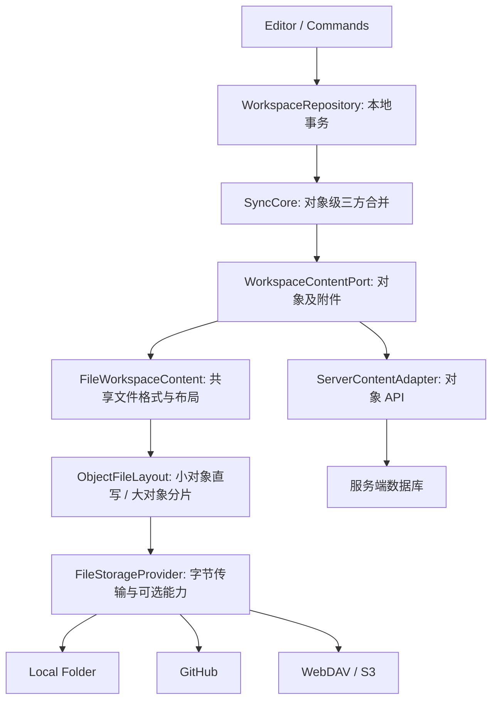

# Tio 产品与架构健康审查

审查日期：2026-10-23。基线：`5b6015b` 及审查开始时的工作目录。原始需求来自 `docs/.local/PRODUCT_DESIGN.md`、`TECH_STACK_RECOMMENDATION.md`、`CENT_ARCHITECTURE_SOURCE_ANALYSIS.md`；它们是本地需求来源，不在本报告复制全文。审查包含源码、现有文档、自动化验证和新增反例，不包含真实 GitHub/WebDAV 联调、原生目录授权、移动硬件性能或完整安全审计。

**结论：方向基本正确，但尚不适合冻结为长期数据协议或对外稳定编辑器 SDK。无需推倒重写；应先补齐合并正确性、统一领域校验、版本演进和共享文件存储层，再扩充后端与编辑器类型。** 当前没有通用大文件拆分能力；一条 Record 一个文件只能避免“整库单文件”，不能解决巨大 Page、巨大 Record 正文、文件数量增长和全量同步成本。

本次只增加审查文档与可复现测试，没有修改业务实现。`architecture-audit.md` 是上一轮历史审计，不能当作本轮问题已修复的证明。

## 1. 应保留的基础

- `WorkspaceRepository` 隔离宿主持久化，`WorkspaceRuntime` 管理确认快照与乐观命令；Web 与独立编辑器共享会话能力。
- `SyncCore` 与 `HostSyncRunner` 已分开，同步由宿主提交事件驱动，可以在没有编辑器时运行。
- `WorkspaceContentPort` 已允许对象型后端；`FileStorageProvider` 是普通文件传输边界，Git 信息没有污染业务对象。
- 稳定对象/字段/块 ID、规范 JSON、墓碑、附件 ID、未知字段保留、opaque block 都是正确方向。
- 本地提交包含业务对象、附件提升、版本和回执的事务；上传确认保留实际上传基准，不直接清除后续修改。
- 有包依赖边界检查、编译产物 CSS 隔离检查、独立编辑器测试、生产 PWA 测试。不要为追求包数量再拆空壳，也无需因此改用 CRDT。

## 2. 原始需求符合度

| 原始要求                               | 当前证据与结论                                                                                                           |
| -------------------------------------- | ------------------------------------------------------------------------------------------------------------------------ |
| 离线先写、本地恢复                     | 已有 IndexedDB、失败状态、重试和 PWA；浏览器用例通过。内存 pending 仍不是持久化草稿日志，配额失败/进程终止边界必须明确。 |
| 页面、Database、Table、Record Detail   | 已实现；Board、命名视图、多条件 UI、回收站也已存在，不能沿用旧 roadmap 说它们全部缺失。                                  |
| 默认 GitHub 端点                       | 未实现；当前只有设备/文件夹产品入口。它是原始 P0/M4 缺口，不能把当前 demo 等同原产品完成。                               |
| 对象级三方合并，无人工冲突选择         | 部分实现；R01–R03 表明恢复、移动、同段并发没有闭环。                                                                     |
| 可扩展类型：验证/序列化/迁移/合并/降级 | Registry 只有部分能力；缺少完整贯穿路径，见 R05、R09、R11、R12。                                                         |
| 大 Database 按需读取、仅同步所需对象   | 未满足。画布表格虚拟渲染不等于数据按需加载，见 R07、R08。                                                                |
| 可移植纯文本与附件                     | 小规模当前格式往返已验证；没有分片格式，归档资源边界不充分。                                                             |
| Formula/Rollup、Calendar               | Formula/Rollup 目前只保留定义，不计算；Calendar 未实现。属于后续能力，不能以这些功能缺失为理由重写存储。                 |
| 不依赖专用服务端，未来支持高性能后端   | 当前接口已具备对象后端入口，应保持；新增数据库后端无需参与文件分片。                                                     |

## 3. 优先修复的具体问题

优先级：P0 为数据安全/基本编辑闭环，应在扩大真实使用前解决；P1 为冻结协议或扩容前解决；P2 为工程维护及体验改进。标注“复现”的条目有本轮测试，其他明确为源码结论或待验证风险。

### R01 · P0 · 已同步的删除无法可靠恢复【复现】

位置：`packages/merge/src/index.ts:105`，`packages/sync/src/core.ts:73`。

步骤：创建页面并同步 → 删除并同步 → 本地恢复 `deleted:false` → 再同步。结果：本地再次变为 `deleted:true`。合并器只要一侧有墓碑就无条件删除，甚至没有先判断远端等于共同基准。此时是单侧恢复，不是并发删除冲突。现有回收站浏览器测试运行在本机模式，所以没有覆盖此缺陷。

建议：先处理 `local=remote`、`local=base`、`remote=base` 的三方快路径，再对真实并发的删除/编辑使用明确策略。定义恢复是相对已确认墓碑的新变更；不要靠清空 syncBase 绕过。验收覆盖删除→同步→恢复→多设备重连，以及恢复与再次删除并发。

### R02 · P0 · 跨父级移动与编辑没有按全局 Block ID 合并【复现】

位置：`packages/merge/src/index.ts:51`、`:115`。

初始 A.children=[X]、B.children=[]；本地把 X 移到 B，远端编辑 X 文本。结果：B 中 X 保留旧文本，远端编辑被当成旧父级上的 delete-edit 丢到 recovery。实际复现是**丢失编辑，不是整个块必然消失**。业务主视图无法读到新文本，且 recovery 暂无浏览入口。

原因：只在每个兄弟数组里按 ID 合并，无法区分跨数组移动与删除/新增；事后去重也不能恢复正确的父级和内容。

建议：合并阶段临时构建文档级 `blockId → payload/parentId/order` 索引，分别合并内容、父级与顺序，再确定性修复环和重复挂载。无需立即改变持久化嵌套 AST。补移动+编辑、双移动、移动+删除、祖先删除、重复 ID 性质测试。文本多 run/marks 目前常整体裁决，也需独立定义保守回退，不能宣称所有富文本都支持 Diff3。

### R03 · P0 · 本地并发正文冲突会阻断保存队列【命令复现，队列影响为源码推导】

位置：`packages/workspace/src/commands.ts:53`，`packages/workspace/src/runtime.ts:188`、`:215`。

`editBlocks` 得到 warnings/recovered 就抛出 `Concurrent document edit requires resolution`，虽然 merge 已有确定性结果。Runtime 保留失败命令并停止 drain；retry 继续重放同一个 previous/next，在对端状态不变时仍然失败，后续命令排在它之后。此行为与“无感自动解决、同步不能阻止编辑保存”的要求冲突。

建议：把自动合并结果和恢复副本一起提交，诊断不等于保存失败；只有无法构造合法对象时才隔离该对象，并保留可导出的持久草稿。新增完整 Runtime 双会话测试，验证冲突后继续输入、flush、刷新、关闭均能结束。不能简单删除 throw 而丢掉恢复副本。

### R04 · P1 · 领域约束只存在于部分编辑命令，宿主可绕过【复现】

位置：`packages/core/src/commit.ts:33`，`packages/core/src/index.ts:120`，`packages/workspace/src/commands.ts:62`，`packages/database/src/index.ts` 的 `validateValue`。

直接提交数值字段的字符串值会成功；core 只验证 properties 是对象。编辑器的 cell 命令额外检查数值/布尔，但通用 patch、原生宿主或未来脚本可以绕过。标题、日期、选项和关系字段的校验也不完整。关联失效应该允许降级，与任意新建非法值必须区分。

建议：共享 `validateMutation(before, after, context)`，校验本次变更的已知值和身份规则；历史未知/孤立值保留、只读降级，不能因为收紧校验就拒绝整个旧文档。将完整领域验证放在宿主事务边界，编辑命令复用它做即时反馈。不要让 core 反向依赖 database 形成环，可拆出纯领域规则层或注入字段注册表。

### R05 · P1 · 注册的新类型校验器不参与普通提交【复现】

位置：`packages/core/src/registry.ts:19`、`:38`，`packages/core/src/commit.ts:33`，`packages/serialization/src/index.ts:17`。

注册必需属性校验器后，`registry.decode` 会执行校验，但 `applyCommit` 和 `encode` 只调用全局 validate，不会执行插件校验器。无效插件对象能进入仓库并导出，之后读取反而失败。

建议：拆分 envelope 检查、当前版本 payload 校验、迁移三种操作，提交和序列化统一调用当前版本校验。保留未知对象的 opaque 通道；不要让 `validate → registry → validate` 互相递归。为 Memory、IndexedDB、JSON Bridge 跑同一套契约测试。

### R06 · P1 · 一个坏文件会使整个空间同步失败【复现】

位置：`packages/sync/src/content.ts:23`，`packages/sync/src/core.ts:30`、`:35`。

`list()` 解码所有对象，其中任意 JSON 损坏或路径身份不匹配就抛出；core 的预分类读取也在逐对象 try/catch 外。复现：远端一个 broken.json 导致无关的本地新页面无法发布。重试整轮不能修复此情况。

建议：枚举返回对象描述和逐项读取错误，隔离损坏对象继续处理无关对象；不能把失败误认为 missing 后覆盖。附件失败按依赖对象阻塞，不应始终暂停整个空间。远端扫描不完整时也不能自动修复父树，否则暂时没读到的父级会被当成永久缺失。

### R07 · P1 · 无变化同步仍有 3N 次对象读取和附件全量下载【计数复现】

位置：`packages/sync/src/content.ts:25`，`packages/sync/src/core.ts:35`、`:47`、`:90`，`packages/sync/src/index.ts` 的 10 秒轮询。

一次无变化同步：list 解码一次、分类读一次、实际合并读一次；N 个对象为约 3N 次对象内容读取，尚不计目录枚举、附件及变更写前重读。本轮单对象计数明确为 3。每个附件也读远端二进制，哪怕本地已有。Local Folder 产生文件 I/O，HTTP 后端会放大延迟和请求成本。

建议：本轮读取缓存先去掉重复获取；描述符包含 type、可选 opaque fingerprint/byteSize；支持分页和可选 changes cursor。首次建立基准允许全量扫描，无变更周期只查元数据；最小四方法 provider 仍应正确退化。写前并发检查需要新鲜读取，不能误用缓存。指纹是优化线索，不能把普通文件接口宣传成 CAS。

### R08 · P1 · 单次输入仍触发全空间扫描，撤销持有全空间快照【源码确认】

位置：`packages/workspace/src/runtime.ts:159`、`:170`、`:221`，`packages/local-store/src/index.ts:74`、`:125`、`:215`，`packages/web-editor/src/controller.ts`，`packages/views/src/index.tsx`。

Runtime 每次 dispatch 遍历所有对象并对每个对象 find 原值，至少对象查找是 O(N²)；每个命令提交前读取完整 snapshot，LocalStore.commit 再 getAll。readChanges 虽然只返回增量，却先读出全部变化条目。remember 命令的 before/after 是完整空间深拷贝，history 无界。UI 订阅整个 state，查询再过滤/排序全数组。

一万条记录查询的合成测试通过，并不能证明在一万条记录空间里逐字输入没有卡顿；现有性能测试主要测纯排序和批量写入，没有测这一链路。

建议：对象 Map 与按 ID selector；提交请求保留 expectedVersion 作为早期方案，但增加 readObjects/queryRecords 分页端口、对象 revision 前置条件和必要依赖读取；IndexedDB 增加 workspace/database/type/变化版本索引。撤销只存受影响对象/字段的 inverse，设字节预算。短时连续同对象编辑合并提交，不能合并掉具有顺序语义的动作。先仪表化输入→本地 ACK、提交读字节量、undo 内存，再决定是否需要 Worker。

### R09 · P1 · 迁移函数存在，但升级的持久化流程未贯通【复现】

位置：`packages/serialization/src/index.ts:21`，`packages/core/src/registry.ts:19`，`packages/core/src/commit.ts:38`，`packages/local-store/src/index.ts` 的 `reconcile`。

本地已保存 v1，自定义类型注册当前 v2 与合法 v1→v2 迁移；远端 v1 经 decode 变为 v2，但同步走普通 reconcile/commit，因 schemaVersion 变更被拒绝，本地仍是 v1。现有手工 migration commit 测试通过，不等于启动、读取、同步能自动使用这条通道。

远端变为未来版本时，core 只在本地没有对象时保留远端；本地已有旧版则仍保留旧对象，UI 的 editable 只看旧对象支持度，因此“检测到新版后只读”也没有完整落实。

建议：宿主负责显式 migration transaction；读取区分 raw snapshot、migrated projection、needsMigration、unsupported。先持久化升级，再允许编辑；共同基准也必须按同一规则比较。保留新版原始副本与旧版草稿，禁止自动覆盖或静默丢弃其中之一。区分业务 schemaVersion、文件 storageFormatVersion、bridge protocolVersion 和插件版本，不要用一个数字承担四种兼容性。

### R10 · P1 · 缺少共享文件布局/分片层【源码确认】

位置：`packages/storage/src/index.ts`、`packages/sync/src/content.ts:42`、`packages/serialization/src/index.ts:24`。

write 对整个对象 encode 后写单文件。没有容量阈值、manifest、分片校验、发布顺序、失败恢复或读取重组协议。大量 Record 是大量独立文件，不会自动形成一个巨大数据库文件；单 Page/Record 的正文却会无限增长。目录文件数和大对象要分别治理，不能只按“每 1000 条切文件”处理所有情况。

建议架构及兼容方案见第 4 节。在 LocalFolderProvider 内单独切文件会迫使 GitHub/WebDAV 重复实现，这是应立即避免的方向。

### R11 · P1 · 类型/字段/视图/编辑器扩展点尚未形成完整协议【源码确认】

位置：`packages/core/src/registry.ts:2`，`packages/core/src/index.ts` 的 TioObject/knownTypes，`packages/editor-blocknote/src/index.tsx:92`，`packages/views/src/index.tsx`，`packages/core/src/host.ts` 的 Connection。

ObjectRegistry 不含 merge、引用收集、codec 或降级能力；merge 是通用递归函数。编辑器 schema、样式白名单、菜单固定在模块内；字段验证/显示/输入散布多处；视图 layout 是 table/board 分支；Connection kind 固定 device/folder。新增一种业务类型仍需跨层修改。TioObject 是可选属性大袋子，允许编译期构造“record 没有 databaseId”等不合理状态。

建议：内置已知对象使用判别联合，未知类型保留 UnknownObject envelope；按应用实例注入 registry，避免全局单例污染双编辑器/测试。将纯数据插件（validate/migrate/merge/references）和 UI 插件（block/inline/style/field/view renderer）分开，不能把 React 放进 core。宿主注册连接工厂及不透明配置引用，不在业务对象存凭据。首个验收插件可用一个简单 callout block 和一个自定义字段，不需要先开发完整插件市场。

### R12 · P1 · 未知内容保护没有覆盖表格和全部结构【源码风险，未做新增浏览器复现】

位置：`packages/editor-blocknote/src/index.tsx:110`、`:127`、`:138`。

safeInline 对非数组直接返回 true；tableContent 是对象，其中 cells 的未知 inline/style 没有递归检查。fromEditor 会用编辑器输出整体替换 content，因此一旦第三方规范化掉未知数据，原值不会补回。已知块未知 props 有回填、未知块有 raw，这些保护应保留，但不足以支持“所有未来内容无损”的承诺。对于 null inline 等非法输入，还可能在进入 placeholder 前抛错。

建议：按 block codec 做递归可编辑性判定，覆盖 table rows/cells、links、inline、styles、props 值域；不能安全映射的最小子树 opaque 化。建立当前全部默认块及未来 nested payload 的真实编辑器往返 fixtures，测试打开→编辑邻接内容→保存。不要简单把整个 table 永久标成只读。

### R13 · P1 · 可变路径与对象 ID 的一致性约束不足【源码确认】

位置：`packages/core/src/commit.ts:43`，`packages/serialization/src/index.ts:33`，`packages/sync/src/content.ts:32`、`:42`。

record/view 的 databaseId 影响路径，但普通 patch/commit 未禁止改变它。发布到新目录不会删除旧文件；扫描遇到同 ID 的两个合法路径时，Map.set 静默覆盖。导入有重复 ID 检查，远端扫描没有。以后做“移动记录到另一个数据库”尤其危险。

建议：先禁止通用 patch 改变路径相关身份；显式 move 命令定义旧路径墓碑/重定向/清理语义。共享文件层检测重复 ID 并隔离，不能依赖枚举顺序。长期可以让对象定位基于 ID，业务归属独立；不必立即强制迁移全部既有路径。

### R14 · P1 · ZIP 限额检查发生在分配之后，且未协商归档版本【源码确认】

位置：`packages/serialization/src/index.ts:62`、`:69`。

unzipSync 先解压全部允许条目，然后才检查总计 200 MB。每条小于 100 MB 并不限制总分配；filter 还会跳过过大条目，可能造成不完整导入。导出写 tio-export.json version=1，但导入不检查它。导出/导入均整体同步处理，大空间会阻塞 UI 并放大内存。

建议：读取归档目录先检查版本、条目数、声明总量、路径与重复项，再受限解压并检查实际输出总量；超限明确拒绝而非静默过滤。大归档用 Worker/流式管线，分片物理备份与逻辑对象导出必须标注不同格式。加入很多小压缩条目、未来版本、重复路径、超大单对象用例。

## 4. 共享文件适配层的目标设计

以下是建议协议，尚未实现。它利用当前 WorkspaceContentPort 边界做增量演进。



建议把 `FileWorkspaceContent` 从 sync 包移到独立 `file-storage` 包（名称可调整），避免同步核心越来越理解路径和文件格式。storage 保留最小传输接口及错误/能力描述；业务 serialization 负责逻辑对象规范 JSON。文件布局 codec 不能混入业务 merge，数据库后端不依赖它。

### 4.1 三种容量问题分别处理

| 问题                                 | 处理方式                                                                       | 不应采用的方式                             |
| ------------------------------------ | ------------------------------------------------------------------------------ | ------------------------------------------ |
| Record 数量增长                      | 继续一记录一对象；分页枚举、分目录、索引、增量同步；必要时增加可选 pack layout | 所有记录塞到 database.json，再每次整库重写 |
| Page/Record 单对象过大               | 文件层以字节预算和稳定块 ID 拆分正文，读取时还原完整逻辑对象                   | 让页面 UI 或每个 provider 自己识别分片     |
| 单个 block/未知 payload/字段数组过大 | 通用 JSON 子树分片与超大字符串可逆切分，或明确可诊断大小上限                   | 声称按顶层 block 拆分就能限制任何文件大小  |

第一版优先小对象直写 + 大对象分片，不急着增加 Record pack，避免同时引入多个对象共写一个分片的竞争。未来若启用 pack，应有独立布局版本、稳定分桶、分裂规则和并发覆盖处理；不能按列表下标每 N 条切分，否则头部新增会使后续全部重排。

阈值按 **UTF-8 编码后字节数**计算，并预留 JSON envelope 开销；不要按字符数或条数推定大小。初始可试验 256 KiB 目标/512 KiB 上限，但这是待基准验证的默认策略，不是已证实最佳值；provider 的 maxWriteBytes 可进一步约束。设置上下水位，防止阈值附近反复切换。manifest 也必须有大小上限，巨大索引采用分级/分桶，不能把巨型业务文件换成巨型 manifest。

### 4.2 文件格式示意

```text
workspaces/<w>/pages/<id>.json              # 小对象保持现有 v1
workspaces/<w>/objects/<id>/head.json       # 分片对象的格式/身份/根引用
workspaces/<w>/objects/<id>/chunks/<hash>.json
```

目录只是待定示意；head 需含独立 storageFormatVersion、对象身份、逻辑摘要、根分片引用。分片使用 UTF-8 JSON、内容哈希命名、写后不可变；逻辑 schemaVersion 不因物理拆分而变化。文本按可逆 JSON 结构编码，不能把业务 JSON 压成不透明二进制；超大字符串分段需要明确拼接规则，保留未知字段与顺序。

分片按稳定 Block ID/JSON 子树组织，内容变更只重写有关分片；顺序单独表示，避免普通插入移动所有字节边界。逻辑对象 hash 应基于重组后的 canonical payload，与切片尺寸无关。仍在对象级执行 merge，不能合并 manifest 来代替业务冲突处理。

### 4.3 发布、失败恢复与垃圾回收

1. 计算新分片；上传不存在的不可变 chunks，验证可读性/长度/摘要。
2. 所有依赖就绪后才发布小 head，读者取得一次 head 后只按其固定引用读取。
3. 若缺片/摘要不符，返回 incomplete/corrupt，保留本地和上一有效 generation；不能视为对象删除。
4. 更新 head 后确认实际远端逻辑快照，再记录 syncBase。失败重试使用相同内容地址，不生成无限重复分片。
5. 旧分片不能立即清理；在可靠扫描、保留期和读者安全条件满足后做 GC。第一版可不自动清理并明确空间成本。

**普通四方法文件接口不保证 head 覆盖原子性、read-after-write 或多文件事务。** 不可变 chunks + 最后写 head 能缩小半写窗口，但不能自动给所有端点提供原子提交。需定义最低读写可见性契约，并提供可选条件写/原子替换/批量提交能力；弱端点至少检测破损、保留可恢复 generation。若采用扫描不可变发布标记作为 fallback，必须另行定义多个 head 的发现/选择/合并规则，不能靠客户端时间戳挑最新。不要先实现半套协议就承诺 crash-safe。

强能力 provider 可优化发布：GitHub 的 tree/commit/ref 操作放在适配器内，WebDAV 条件写只在服务器支持时启用；Local Folder 保持浏览器文件能力边界。无法避免的最后写覆盖仍按原产品 best-effort 边界说明。

### 4.4 兼容策略必须先于首次分片写入

新客户端需兼容现有单对象文件；同一逻辑对象只允许一种明确的权威布局，禁止无规则双写。小改动不应重写全空间。转换流程要可重入、可回滚，并检测旧布局/新布局重复身份。

**当前已发布代码不认识分片文件，不能靠新增一个 capability 字段让它自动变安全。** 它可能把缺失的旧文件当故障，也可能继续写旧路径。因此必须先发布能识别格式门槛并只读拒绝的桥接版本；旧客户端无法升级时，新格式需使用隔离的空间/目录，并明确迁移切换，不能保证新分片对现有旧二进制完全透明。不要留下旧页面快照来假装兼容，那会形成两个真值。

业务版本的“新客户端读旧格式”和“旧客户端保存新格式”是两种不同保证。后者必须以只读/opaque/协商为前提，无法承诺任意未来格式仍可编辑。

### 4.5 接口演进建议

- ContentPort 枚举返回 `{items, cursor?, issues}`；描述符包含 id/type、可选 revision/fingerprint/byteSize。分页不是跨页快照保证，需要定义扫描 token 或保守重扫策略。
- `read(id)` 返回有区别的 found/missing/unsupported/corrupt/incomplete；网络和鉴权故障独立错误码。不要把这些状态都压成 undefined。
- 写入支持可选 expectedRevision；返回 committed revision 与能力语义。没有条件写的端点仍可运行，但不能伪造 CAS。
- FileStorageProvider 保留最小 list/read/write/delete，可选 stat、分页、batch、conditionalWrite、AbortSignal；Git SHA 等只作为不透明版本或适配器内部实现。
- 附件元数据和二进制引用独立；本地命中后不重复下载远端二进制，按摘要/不可变身份确认。数据库后端自行决定附件存储，无需使用 JSON 分片。
- 鉴权/发现/重授权保留 ConnectionAdapter，别把登录、邀请成员塞进 FileStorageProvider。

## 5. 编辑器扩展与兼容方案

建议每个编辑器实例接收不可变的 schema bundle。纯对象插件负责识别、验证、迁移、merge、引用收集和 opaque 策略；BlockNote 插件负责 block/inline/style specs、菜单、映射；字段插件负责值校验、比较、输入和展示；视图插件负责渲染共享查询结果。core 不导入 UI。

统一规定未知数据“可读、保留、不可误写”；迁移不得修改稳定 ID；第三方编辑器升级必须跑 golden fixtures。现有 Block AST 已使用 BlockNote-compatible table 结构，应正式冻结 v1 语义并以 codec 隔离后续变化，不要声称当前格式与第三方完全无关。

独立挂载接口还需定义外部更新期间的 selection/IME、undo 与对象版本关系。现有 `sent` 用完整 JSON 字符串判定回声且 `replaceBlocks` 整文替换，建议转成提交身份/对象 revision 协议并测试选区、输入法和撤销；本轮没有证明它们已经故障。

对外 SDK 发布前增加构建 JS 与 d.ts、exports/peerDependencies 和 API 兼容快照；当前 private workspace 包直接导出 TSX，适合作为仓库内部依赖，不能直接当成成熟 npm SDK。先明确版本政策，再决定是否公开发布。

## 6. 其他工程问题与发布门槛

| 主题        | 当前情况                                                                                                                                | 建议                                                                                                            |
| ----------- | --------------------------------------------------------------------------------------------------------------------------------------- | --------------------------------------------------------------------------------------------------------------- |
| Bridge 契约 | 有 JSON 编解码、版本、session、workspace 检查；payload 仍多处 any，部分校验很浅                                                         | method 判别联合、完整 schema、消息大小/深度/超时限制；保留 unknown 扩展输入。                                   |
| 权限边界    | readSnapshot 可过滤对象/字段，但 LocalStore.readAsset 只按 ID 取二进制；当前本地模式 fullAccess                                         | 在提供受限宿主前验证附件授权与事件信息过滤，不把客户端 AccessPolicy 当服务端安全边界。本轮未做攻击测试。        |
| JSON 约束   | unknown 字段支持宽泛 JS 值，本地 structuredClone 与 JSON 传输可产生不同表示                                                             | 递归 JSON-safe 验证，有限数值、深度/节点/字节上限；未知字段保留的是 JSON，不是任意 JS 实例。                    |
| 生命周期    | stop 等待当前 I/O，但端口没有取消/截止时间                                                                                              | 慢后端可能长期阻塞 disconnect，添加取消与“请求已发送但结果未知”的恢复语义。                                     |
| 缓存/历史   | 回执有确认水位是进步；recovery 全库保留 100 条；session watermarks 和 staged 数据缺少完整回收政策                                       | 按空间和字节预算管理 recovery；暂存租约；失联客户端回执保留/压缩协议，不承诺无限期重试。                        |
| 诊断        | merge warnings 没有完整结构化传播；状态没有 lastSuccess/传输量等指标                                                                    | 对象/端点错误码、重试分类、最近成功、请求数与字节计数；用户仍不需看到 Git/CRDT 术语。                           |
| 文档漂移    | data-format 使用 `dataworkspaces/`，实际是 `databases/`；README 5173，配置 6789；verification 仍写 54/17，roadmap 未反映命名视图/回收站 | 当前审查以代码和本轮 58/20 为准；统一规格来源，发布时由 fixtures/测试验证示例，避免贡献者按错误路径实现适配器。 |
| 包体与平台  | 构建成功但有大 chunk 警告；桌面 headless 测试通过                                                                                       | 记录真实设备首开/内存/IME；不要靠调高警告阈值宣称性能解决。                                                     |

## 7. 推荐实施顺序与完成条件

| 阶段              | 范围                                     | 完成门槛                                                                                         |
| ----------------- | ---------------------------------------- | ------------------------------------------------------------------------------------------------ |
| A：正确性         | R01–R06，补恢复/移动/并发队列/领域验证   | 对应 expected-fail 改为普通测试通过；完整双设备、Runtime、Bridge 契约通过；失败草稿仍可恢复。    |
| B：协议基线       | R09、R11–R14；类型、版本、路径和归档规则 | v1 golden fixtures；旧客户端只读策略；真实表格未知内容往返；合法迁移端到端成功。                 |
| C：文件能力       | R07、R10；抽出共享文件层、分片与发布协议 | 所有文件 provider 共用同一故障注入套件；最小 provider 和对象型后端均通过；数据库后端无分片依赖。 |
| D：容量与默认远端 | R08、GitHub 连接/鉴权/批量发布           | 1k/10k/更大规模测输入 ACK、首屏、同步请求/字节、峰值内存；实际 GitHub 往返与限流恢复。           |

拆成可独立回滚的变更，避免把 UI 重做、格式迁移与新远端放在一个大提交。接口草案先由契约测试固化，再替换实现。

文件层验收至少覆盖：低于/等于/高于阈值；中文/emoji 字节边界；巨大单 block/单字符串；未知类型；manifest 自身增长；写任意分片失败；head 失败/破损；远端成功但本地 ACK 失败；重试；并发发布；缺片/错摘要；布局迁移中断；旧客户端拒写；GC 不删除在读数据；删除本地缓存后仅凭远端重建。

性能验收不能只给一个总耗时阈值：分别记录冷启动/热启动、一次字符编辑、单字段更新、无变更同步、单对象变更同步、附件缓存命中。无变更周期不得下载全部附件；一个对象变化不能要求重写全部空间。阈值在目标硬件基线后确定，不伪造未测性能保证。

## 8. 本轮验证与测试维护

- 原有 Vitest：58/58 通过。
- 最终 `corepack pnpm check` 完整通过；新增用例后总计 59 passed / 7 expected fail（66），格式、lint、边界、类型检查及两个生产构建均完成。
- 本轮新增 `tests/architecture-review.test.ts`：R01–R06、R09 为 7 个 `it.fails` 已知缺陷；R07 为一个实际读取计数证据测试。**expected fail 不是修复通过**，修复后必须去掉 `.fails` 并保留验收断言；R07 优化后更新预期。
- R01–R06 另临时按普通测试运行，确认分别失败于再次删除、旧文本保留、命令抛错、非法值未拒绝、插件校验未执行、无关对象未发布；临时文件已移除。
- TypeScript、依赖边界、Oxlint 通过；Web 与独立编辑器生产构建、编译 CSS 隔离通过，有既存大 chunk 警告。
- Playwright：20/20 通过，包含真实 OPFS 文件 API、PWA、双实例嵌入、视图及回收站；不等于原生目录/真实设备/GitHub 联调通过。
- 没有修改用户已有 `docs/local.zip`。本报告不给尚未实现的文件分片、旧格式迁移或新后端颁发通过结论。

## 9. 开源设计参照与来源

参照的是明确契约、组合扩展、故障隔离和可测试格式，不是复制大型项目的模块数量。

- BlockNote 官方将 block、inline content、style 分成可组合 schema；Tio 应暴露相应适配注册入口，而不是要求每次改固定 schema 模块。[Custom Schemas](https://www.blocknotejs.org/docs/features/custom-schemas)
- BlockNote 的 table content 是嵌套 rows/cells 结构，解释了为什么只检查顶层 inline 数组不足以证明未知内容安全。[Document Structure](https://www.blocknotejs.org/docs/foundations/document-structure)
- SQLite 对原子提交的讨论说明持久化可靠性需要失败顺序和恢复协议；本报告据此要求分片发布定义故障语义，并不建议把 SQLite 的 journal 原样搬到远端文件端点。[Atomic Commit](https://www.sqlite.org/atomiccommit.html)
- GitHub Contents API 文档明确目录列举和不同文件大小的限制；未来实现不能假设一次 list 覆盖任意大目录，也不能只因文件变小就忽略请求数量。[Repository Contents](https://docs.github.com/en/rest/repos/contents)
- GitHub ref 更新属于 provider 专属能力；不得把 branch/SHA/commit 变成所有后端必须实现的领域接口。[Git References](https://docs.github.com/en/rest/git/refs)

来源查阅于审查当日；具体实现仍以仓库锁定依赖、对应版本测试和实际 provider 契约为准。
