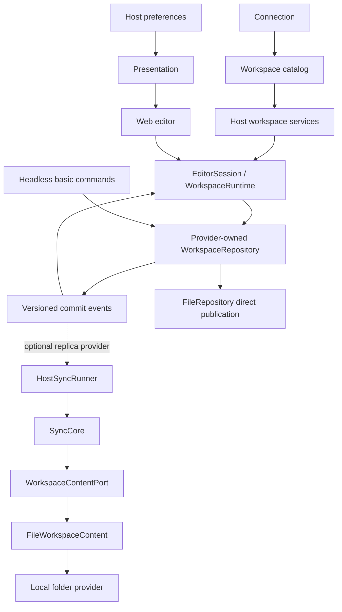

# Host-owned workspace architecture

## Ownership

The application has one active **Connection**, containing multiple **Workspaces**. A workspace is the largest content-sharing boundary and has exactly one synchronization endpoint. A connection is an authorization/discovery entry, not a shared document or an ACL container. This implementation includes device-local and local-folder connections. GitHub, custom servers and native platforms are not implemented.

The host owns connection authorization, the workspace catalog, navigation, local repositories, preferences, access policy and synchronization. The editor owns rich-text/database interactions and transient selection, focus and dialogs. `EditorSession` is the shared editor-facing interface used by Web composition and independent embedding.

## Connection and workspace lifecycle

Selecting a root folder establishes a connection and shows its workspace catalog. It does not automatically create a workspace. Users create, rename and switch spaces under that connection. The device connection follows the same flow. Folder manifests are discovered under `workspaces/<workspaceId>/workspace.json`; there is no second authoritative on-disk catalog.

`WorkspaceDescriptor` holds identity and connection ownership. `WorkspacePreferences` holds local selected-page/favorite state. `LocalCatalog` stores descriptors and personal preferences separately. File handles belong to the connection record, never to business objects.

Switching space flushes local commands and closes the old editing session. Repositories and sync runners remain alive for the active connection, including spaces without an editor. Local flush failure prevents switching. Remote failure does not. Host services serialize open/close operations. Disconnect stops scheduling, waits for running tasks to reach completion/cancellation boundaries, closes repositories and clears the active connection. Device persisted content remains available on reconnection; folder unfinished operations remain in the recovery journal.

## Presentation and CSS

The Web host preference service owns theme and language and persists them outside business content. Theme/language switchers are controlled inputs. `EditorSurface` receives an explicit `Presentation`; standalone mounts receive host configuration and expose `setPresentation`. Each editor has scoped theme, locale and portal contexts. UI packages have no mutable global theme authority.

Editor CSS is processed by `scripts/editor-css.mjs`, including third-party stylesheet rules. Global root selectors and utilities are scoped to the editor instance. `check-editor-css.mjs` checks compiled output; browser tests assert computed host/editor colors, not just HTML classes. Host CSS has its own tokens. Shared visual values do not imply shared mutable state.

## Commands and state

`WorkspaceCommand` is serializable. Its executor performs patch/create/append, rich-text changes, cell edits, explicit field operations, move and restore. Field operations are calculated against the editing snapshot and replayed by stable field ID; independent additions are retained. Record creation validates the current database fields on every replay. Overlapping rich-text merges that produce recovered alternatives raise a conflict rather than silently reporting successful preservation.

`WorkspaceRuntime` owns the confirmed baseline, optimistic command queue and transaction receipts. Inputs read the synchronous projection; components retain interaction state, not separate persistence queues. Runtime lifecycle is opening, ready, flushing, closing, closed or error. `close()` flushes and refuses new commands while closing; failure retains pending work.

Repository events contain workspace version, commit identity, origin and changed IDs. Runtime serializes event ingress with in-flight commits, uses receipts before recovering uncertain writes, then applies remaining commands over confirmed state. Events can be duplicated or missed: incrementally reading from the version cursor and re-reading before CAS retries recovers current state. A receipt and its change notification cannot execute a command twice. Saved means committed by the selected provider: an IndexedDB transaction for device storage, or completed file publication for folder storage.

## Persistence and permissions

`WorkspaceRepository`, `AssetStore`, `SyncStateStore`, `WorkspaceCatalog` and `HostPreferences` describe separate duties. The device provider uses IndexedDB for atomic transactions. The folder provider writes files directly with a minimal recovery journal and recoverable best-effort commits. See [asynchronous provider access](async-provider-access.md). The editor never opens IndexedDB. The database has a new initial namespace and schema; no historical formats or migration compatibility paths are implemented.

A commit validates identity, format and access. Atomic providers use workspace-version CAS; file providers serialize cooperating writers and recheck files, without promising atomic multi-file visibility. It returns changed entries only. Runtime requests carry client ID and sequence. Acknowledged receipts are removed and a client high-water mark prevents replay; compacted requests are never executed again. Unacknowledged requests retain their compact result. Incremental storage retains one latest change per object, not a workspace snapshot per keystroke. Initialization requests navigation metadata and the selected body; explicit exports traverse the workspace. Scanning providers may still read all files internally.

`AccessPolicy` resolves operations on workspace/page/database/record/field/asset resources. The host checks writes independently of UI controls. Read projections filter unavailable resources/fields, and unreadable fields survive updates to authorized fields. Native adapters must bind repositories and channels to the correct workspace and identity. Endpoint ACL inheritance is not assumed by shared code.

Attachments are staged separately from committed binary reads. Atomic providers promote staged bytes and metadata together. File publication writes assets first and retains unfinished operations in its recovery journal. Binary-only repairs explicitly commit even when metadata is unchanged. Transport references are released after host consumption; a client timeout is not cancellation. Loopback uses expiring transfer references and actual JSON roundtrips for messages. Production native transport implementations must implement the same lease/ACK behavior.

## Optional replica synchronization

The following components apply to providers that maintain a replica. The current folder connection uses direct publication and does not run this synchronization pipeline.

`SyncCore` works with a workspace content port: object discovery/read/write, binary read/write and refreshed publication authorization. This allows record/API backends without imposing a file tree. `FileWorkspaceContent` alone maps objects to canonical paths and verifies path identity. File providers implement filesystem primitives.

`HostSyncRunner` owns timers, trailing debounce, visibility, lock injection, retries and completion. Host repository events schedule all local writes, including other windows and headless commands. Sync ingress is marked separately to avoid feedback scheduling. Continuous edits reset a 1-second trailing timer; polling/retries defer to it. Manual sync can run immediately. Web host queues space runners and uses Web Locks.

Remote authorization is refreshed before publishing changed objects. Denial preserves local content and reports a permission issue; users can retry, export or discard a draft with a confirmed remote baseline. Discarding a never-published object creates a local tombstone and does not publish a remote deletion. No draft is sent to another endpoint.

Attachments precede referencing content. Three-way merge uses each space's endpoint baseline; reconcile uses CAS and ACK records the published revision. An edit occurring during upload remains dirty. Missing acknowledged files are issues, not deletion. Tombstones represent deletion. File synchronization remains best effort: filesystem providers have no cross-file transaction or remote compare-and-swap guarantee.

## Format evolution and boundaries

Each host owns an instance-scoped domain registry used by commits and runtime commands. Registered validators accept exactly their declared schema version; updates cannot change version or identity. There is no migration transaction or historical reader. Unknown types and keys retain JSON payloads without becoming editable. See `extensions.md` for composition and `file-storage.md` for shared chunk storage.

Boundary checks recursively examine pure-package sources and transitive package dependencies. The editor may depend on browser presentation adapters, but never concrete repositories or connection adapters. Documents and verification evidence are maintained under `docs/`; private original documents stay in ignored `docs/.local/`.

## Offline connection recovery

Restoration follows provider capabilities. Device restoration does not depend on endpoint authorization; folder content requires access to the original folder. `WorkspaceServices.sessions()` reads local descriptors and preferences only. Bootstrap opens the saved workspace through its provider; folder access is checked before opening content. `refreshRemote()` discovers remote manifests. A failed discovery never clears the local catalog or replaces the active editor. Without cached spaces, the connection selector exposes the same recovery action.

`ConnectionAdapter` is a host-only contract: `supportsSync`, noninteractive `getAccessState(workspaceId?)`, optional interactive `reauthorize(workspaceId?)`, state subscription and error classification. States distinguish available, reauthorization-required, unreachable, unrecoverable and forbidden, scoped to a connection or workspace. `ConnectionAccessError` carries this structured state through content operations, including failures partway through publication. Resource-level `AccessPolicy` denial remains a separate publication issue and does not imply that logging in again will grant access.

The folder adapter owns permission queries and requests. Requests execute immediately in the user's click stack, before flushing or awaiting other operations. Background tasks never prompt. For replica providers the host gates queued synchronization and retains local drafts. For direct folder repositories it checks access before opening, makes an open editor read-only on detected access loss, and retains unfinished journal operations until authorization succeeds. Concurrent authorization clicks share a promise; disconnect invalidates late results. Reauthorization must restore the same endpoint and identity: an adapter must return failure for an identity mismatch and must never silently retarget cached drafts.

The device implementation has no remote capability. The Web UI checks capabilities instead of folder-specific connection kinds. Future OAuth adapters can implement the connection contract and supply their own repository/cache policy without changing editor sessions. No OAuth/GitHub implementation is included.
