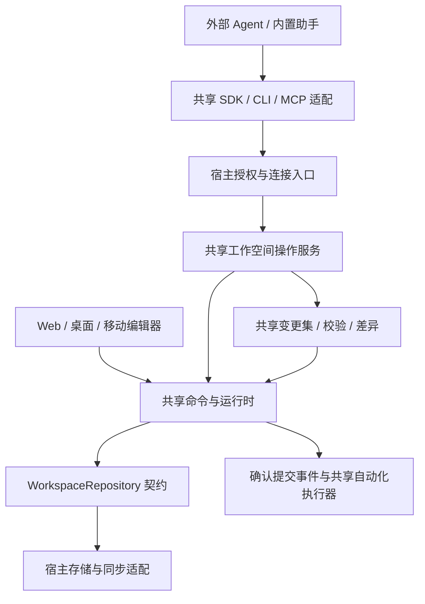

# 本地富文本工作空间与 AI agent 联动

调研日期：2026-10-29。实现进展见[Site tools 使用与验证](../development/site-tools.md)，本文后续架构演进建议不等于本阶段全部交付。本文是产品与架构建议，不是已实现能力或已批准的实施计划。依据当前源码、官方资料及「复刻博客 HTML 静态站点」对话中的实际操作。外部产品能力与 Tio 设计推论分开陈述；配套产品来源见[案例资料](local-agent-patterns-sources.md)。

## 结论

根据后续讨论，方向收敛为：**AI 只通过 Tio 操作接口修改业务数据；各平台复用同一套操作实现，由宿主向外部 agent 暴露能力。** 文档、数据库、视图与自动化规则不提供底层文件直写作为正式编辑入口。

建议把 Tio 定位为「人和 agent 共用的本地结构化工作空间」：人使用编辑界面，agent 使用 SDK、CLI 或 MCP，二者复用命令、校验、变更集与提交语义。草稿由共享服务管理，不要求 agent 编辑另一套数据文件。博客模板、CSS、脚本等普通代码资产仍可使用文件工具。

优先实现平台无关的工作空间操作服务及数据协议，再实现宿主绑定和薄 MCP/CLI 适配。Web、桌面、移动端使用同一份核心实现，平台只负责存储、传输、身份授权与生命周期。无需先重写编辑器，也不必先内置聊天助手。

本文的产品案例保持为研究依据；原先文件草稿优先的建议已被上述接口优先方向替代。变更集的具体 API、执行载体和平台连接方式仍是待设计方案，不代表已实现。

## 当前项目实际上离接入有多远

| 现有能力             | 源码/契约                                                                                                                            | 对接入的意义与边界                                                                                                                |
| -------------------- | ------------------------------------------------------------------------------------------------------------------------------------ | --------------------------------------------------------------------------------------------------------------------------------- |
| 统一对象与字段模型   | [数据契约](../protocols/data-format.md)、[核心校验](../../packages/core/src/index.ts)、[提交校验](../../packages/core/src/commit.ts) | 页面、数据库、记录、视图、自动化都是结构化对象；已有身份、空间、字段值等检查，但不是完整的候选空间语义校验器                      |
| 无界面命令与确认提交 | [runtime](../../packages/workspace/src/runtime.ts)、[commands](../../packages/workspace/src/commands.ts)                             | `checked(expected, changes, guard, options)`、导入、正文/属性修改、撤销重做可复用；新增 agent 入口不能绕过命令时间维护与访问策略  |
| 正式仓库契约         | [repository](../../packages/core/src/repository.ts)                                                                                  | 已有版本、提交 ID、结果查询、事件、附件暂存和能力声明；适合做统一提交服务的基础                                                   |
| 本地文件格式         | [文件存储](../../packages/file-storage/docs/storage.md)                                                                              | 对象 JSON + 内容寻址分片 + 附件；不是所有对象都是可以直接编辑的完整 JSON                                                          |
| 文件可恢复发布       | [FileRepository](../../packages/file-storage/src/repository.ts)                                                                      | 先校验再写日志、发布、恢复，支持回执去重；明确不提供跨进程多文件原子事务                                                          |
| Node 文件访问        | [Pages Node 入口](../../packages/pages/src/node.ts)                                                                                  | 已能复用 `FileWorkspaceContent` 读取/写入文件，但 Pages 适配不等于完整 agent 宿主：缺少持久恢复日志、统一写入协调、自动化生命周期 |
| 编辑器桥接           | [host-protocol](../../packages/host-protocol/src/index.ts)                                                                           | 已有版本化传输、会话/空间标识、可信来源；可复用契约思想，不是现成的本地 HTTP/MCP 服务                                             |
| 自动化执行器         | [自动化架构](../architecture/automation.md)                                                                                          | 监听本运行时确认提交；AI 有 `source.kind = ai`；外部文件变化与同步不补发主动编辑事件；当前会话关闭不继续后台运行                  |
| 富文本不透明内容     | [codec](../../packages/editor-blocknote/src/codec.ts)                                                                                | 未知块/行内内容可无损保留。通用 JSON 合法不代表已知富文本能正确编辑，必须校验编辑器表示能力                                       |

三种存储需要区别对待：

- 设备存储以 IndexedDB 为权威，不能把浏览器的数据库物理文件当作普通工作目录交给 agent。需要通过当前浏览器宿主的操作服务访问，不能让 agent 打开数据库物理文件。
- 文件夹存储确实有用户可见目录，应由宿主独占受支持的正式写入入口；当前恢复日志在浏览器，锁使用 `navigator.locks`，CLI 进程不会自动参与该锁。
- GitHub 存储有本地副本与同步链路。agent 改克隆目录或推 Git 之后，只能按该连接的同步语义进入应用，不能假设触发本会话自动化或立即更新当前输入。

[Web Locks 官方说明](https://developer.mozilla.org/en-US/docs/Web/API/Web_Locks_API)限定为同源标签页/worker 协调；因此“CLI 和网页约定同一个锁名”不能解决跨进程写入。文件夹当前通过可见页面轮询感知外部变化，也不能把半写状态与一笔完整修改区分开。

### 博客案例证明了什么

在[复刻博客 HTML 静态站点](codex://threads/01a17d39-3c0e-7ab2-95e7-cebb0ec8bb5d)中，可确认两类操作：

1. 模板、样式、站点配置等代码文件直接修改后构建、预览，天然适合代码 agent。
2. PageMap 列调整、批量清空默认 slug 等数据操作，使用脚本打开 `folderContent → FileRepository → WorkspaceRuntime`，通过 `runtime.checked(...)` 与 `flush()` 完成。另有备份、数据核对和静态输出验证。

这说明最值得产品化的是「可编程的业务能力 + 文件工作流 + 反馈闭环」。它不能证明任意手改存储 JSON 都安全。案例脚本中使用过内存 journal，进程退出后的恢复能力也不能直接作为产品方案继承。静态构建成功只验证特定读取和渲染路径，不证明数据库引用、编辑器往返、自动化都正确。

## 官方实践与可借鉴方向

本次资料不能证明存在唯一行业标准，但呈现了两类互补路线：文件友好内容通过目录和命令行操作，结构复杂的内容通过应用语义 API 操作。详见[案例资料](local-agent-patterns-sources.md)。

| 路线                            | 适合 Tio 的部分                                                 | 不应误推的结论                                                               |
| ------------------------------- | --------------------------------------------------------------- | ---------------------------------------------------------------------------- |
| Obsidian：本地内容与 CLI        | 让 agent 查找、批量修改、运行脚本；操作可以脚本化               | 文件可读不代表任意富文本/数据库都应变成 Markdown；CLI 也可能依赖运行中的应用 |
| 思源：块结构及应用 API          | 稳定块 ID、局部更新、应用维护内部一致性                         | 暴露底层 SQL 或存储文件写权限不等于正式编辑 API                              |
| Anytype：结构化对象 API/MCP     | 语义对象、版本前置条件、校验和批量修改                          | 尤其 v2 属于预发布，不能拿其接口设计当作成熟性或稳定性证明                   |
| Codex/Claude Code：外部工具接入 | MCP 可把现有 agent 连接到 Tio，无需 Tio 自己实现完整 agent 产品 | MCP 是传输与工具发现机制，不自带业务校验、事务或隔离                         |
| Code execution with MCP         | 以可发现 SDK 支持循环、查询与批处理，避免为每项功能堆工具       | 任意代码执行不等于安全；代码运行环境与正式提交权限仍需隔离                   |

Codex 与 Claude Code 官方均支持本地 stdio MCP；可提供同一个 `tio mcp` 入口。它启动的是 Tio 工具服务，让现有 agent 调用 Tio。[Codex 官方 MCP](https://learn.chatgpt.com/docs/extend/mcp?surface=cli)、[Claude Code 官方 MCP](https://code.claude.com/docs/en/mcp)。

另一方向是把 agent 嵌入 Tio：Codex App Server 提供认证、会话历史、审批与流式事件等深度集成接口。这与“Tio 暴露 MCP 给 Codex”是相反方向，不是第一阶段的前置条件。[Codex App Server](https://learn.chatgpt.com/docs/app-server)。

Anthropic 的 Code execution with MCP 说明了按需发现工具定义、代码内批处理的方式。可据此保留现有 AI 草案中的 JS SDK / code mode 方向，同时增加薄 MCP 入口；不必在“全文件操作”和“每个按钮一个工具”之间二选一。[官方文章](https://www.anthropic.com/research/code-execution-with-mcp)。

## 推荐架构：共享操作服务，由宿主绑定和暴露



这里的操作服务是无 UI 的应用层，不是模型专属工具箱，也不另造保存队列。它调用既有领域与命令能力，组织查询、变更集和正式提交。编辑器交互继续使用共享命令与运行时；agent 不模拟点击，也不直接调用未经业务约束的存储写入。

### 哪些代码共享，哪些由平台提供

| 层               | 跨平台复用                                                         | 平台职责                                                |
| ---------------- | ------------------------------------------------------------------ | ------------------------------------------------------- |
| 领域与命令       | 对象/块/字段模型、引用校验、时间维护、修改语义、未知内容保留       | 无需各端重写                                            |
| 工作空间操作服务 | 搜索读取编排、数据库操作、自动化定义操作、变更集、冲突处理、错误码 | 注入仓库、策略、时钟/ID 等必要依赖                      |
| 对外契约与客户端 | 可序列化请求/响应、能力发现、schema、SDK、MCP 工具映射             | 选择传输载体，不改变业务含义                            |
| 执行与存储       | runtime、仓库契约、自动化执行器、同步核心                          | 文件/IndexedDB/原生数据库适配、进程存活、调度、持久恢复 |
| 交互             | 富文本/数据库编辑器、可复用的差异和预览组件                        | 窗口、导航、原生权限、系统文件选择、通知                |

“能力一致”指相同操作在相同数据、授权和 provider 能力下有相同语义、校验与结果；不要求移动端与桌面拥有相同后台存活时间，也不把文件仓库的恢复保证描述成数据库事务。权限、后台能力和持久化等级由 capabilities 明确返回。

不能用“各平台遵守同一协议”冒充“一次实现”：若 Swift/Kotlin/Rust 分别重写业务规则，仍然会发生实现分叉。推荐继续维护一份 TypeScript 核心，Web 直接加载，桌面在宿主侧 JS 进程运行；移动端通过适合该平台的 JS 执行环境或受管理 WebView 运行共享核心，原生侧仅注入适配。具体执行载体需验证包依赖、后台挂起、线程通信、二进制传输和打包约束，当前尚未证明所有移动运行环境可直接使用现有 bundle。不能为保证后台执行而把核心只放在某个文档编辑 WebView 中。

如果未来选择完全原生重写业务核心，就必须承认这是另一条维护路线，需要跨语言契约用例；它不满足当前优先的单份实现目标。暂不为了尚未确定的平台提前改写整个核心为 Rust/WASM。

### 操作服务与现有桥接的区别

当前 `serveHost` 主要代理 `WorkspaceRepository`，其 `commit` 分支直接调用仓库；`executeBasic` 只是少量无界面命令参考，每次调用临时打开 runtime。它们证明已有解耦基础，但都不是完整的外部 agent 操作服务。

新的对外入口应接收业务意图，例如按块 ID 修改正文、按字段 ID 写记录、调整字段定义、配置自动化，而不是将仓库 `commit(changes)` 原样暴露作为主要接口。需要复用命令时间维护、依赖加载、访问策略和正式提交事件。内部可信编辑器仓库桥仍可存在，但不能自动视为外部授权边界。

同一宿主中的外部写入必须与编辑器会话协调：用户未确认的正文/单元格草稿不能因 agent 提交被覆盖。共享仓库本身不能让独立 runtime 看见全部 UI 临时草稿。需要接入现有会话管理，记录待确认输入的占用范围；范围不能准确表达时先保守拒绝。最终放置与桥接方式在实现设计中确定，不宣称当前已实现单一权威会话协调。

宿主指定可信 `source: ai` 和授权空间，客户端不能通过参数伪造来源、提升权限或切换空间。session/workspace ID 只用于路由，不代替认证。确认提交事件由明确的权威入口产生，避免编辑器、桥接和后台执行器重复触发。

## 统一操作契约

建议提供以下能力组，而非每个 UI 按钮一个工具：

- 发现：当前可访问空间、对象类型、字段/块 schema、支持的操作和 provider 保证。
- 读取：按 ID 读取、搜索、分页查询记录与导航、读取指定块及附件。
- 修改：页面与块、数据库与记录、视图、自动化定义；遵守稳定 ID 和空间边界。
- 变更集：创建、追加操作、读取候选状态、校验、差异、准备提交、提交、查询结果、丢弃。
- 执行状态：提交结果与自动化运行结果分别返回；不把主提交成功等同于后续规则全部成功。

协议载荷只包含可序列化数据，不传闭包、DOM、文件句柄或平台实例。每项操作声明输入/输出 schema、所需能力和稳定错误码。客户端 SDK 可生成类型化方法；调用方式可以是进程内、WebView IPC 或网络 RPC，不能因传输方式改变业务语义。

MCP 与 CLI 只是薄适配。SDK 允许 agent 用循环、条件和批量操作完成复杂任务；新增对象类型优先扩充领域注册与可发现能力，不要求每个平台新增一套工具实现。尚未提供实现的类型保持只读/不透明，不因存在通用 JSON 入口就允许任意修改。

## 草稿是接口内的变更集

以下名称只是接口示意，不是已实现 API：

```text
begin → applyOperations → validate → diff/preview → commit
                         ↘ revise / discard
```

开始时记录可信基线和读取依赖；变更集可先新建数据库再添加记录，中间状态不发布到正式空间。单次操作可以先做局部校验，提交前必须对完整候选状态检查。候选 ID 应稳定，便于后续操作引用新对象。

`prepare` 冻结候选内容并产生摘要；预览、授权和提交绑定同一摘要。修改候选后旧批准失效。提交时在写入协调边界内再次检查当前基线、依赖、查询条件和待确认输入；首版冲突即拒绝，不能自动删除版本条件后重试覆盖。

草稿的保存/恢复策略由宿主存储能力提供，变更语义共享。草稿不是第二份正式数据，不参与正式同步和真实自动化触发；不另建直接向底层发布的队列。

简单修改允许按用户授权直接提交，内部仍经过相同校验；复杂批量任务可以预览后提交。结构正确不能判断内容是否符合用户意图。正式撤销是基于当前状态的新提交，不用旧快照覆盖用户后续编辑。

## 统一校验与一致性保障

| 层       | 必要检查                                                     |
| -------- | ------------------------------------------------------------ |
| 请求     | 输入 schema、空间授权、大小/深度/数量预算、附件传输范围      |
| 对象     | 身份、字段类型、系统时间规则、块 ID、已知块结构、自动化定义  |
| 候选空间 | 数据库/记录/视图/规则依赖、导航循环、新附件可用性            |
| 无损     | 未修改的未知字段和不透明块保留，已知富文本编码/解码不丢失    |
| 并发     | 对象与读取依赖版本、待确认输入、候选摘要、查询条件是否仍成立 |
| 提交     | 稳定提交 ID、幂等重试、回执查询、权限复查、provider 持久恢复 |

现有 `applyCommit` 允许缺失数据库暂时通过，以容纳分开同步；字段值检查主要针对本次改变的值。因此不能把它直接视为完整的候选空间校验器。字段定义改变后，受影响记录和规则仍需检查；复用已有领域能力补齐，不能各端实现不同检查。

引用规则按既有契约分类：删除目标后保留失效提及、删除字段后保留旧值，不应被新校验器擅自清空。新增非法归属、跨空间引用和规则目标则按相应语义阻断。未知块原样保留与已知块写入非法内容是不同情况。

诊断包含稳定错误码、对象 ID、字段/块位置和修复信息。当前底层仍存在普通 Error，新增服务应建立明确诊断契约，不能根据中文展示文本决定重试。

接口不能提升 provider 的物理保证。当前文件仓库仍是可恢复发布，而非跨文件原子事务；所有受支持的写入由统一宿主协调，不能让 CLI 与浏览器各持独立恢复日志同时写同一目录。需要严格跨对象可见性时，再选择事务型仓库或所有读取者共同遵守的快照发布协议。

仅提供 API 也不会自动阻止具有操作系统写权限的 agent 绕过接口。强保护需要由宿主持有正式存储写权限，agent 只获接口授权；否则应准确描述为受支持的操作方式，而非无法绕过的隔离保证。

## 自动化与各平台生命周期

规则配置、启用、预览试运行和真实执行必须分开。预览在隔离候选状态运行，不产生真实记录或外部副作用。正式提交成功后才形成主动修改事件；规则启用不补跑历史事件。

复用共享自动化执行器，由宿主负责存活和调度。同一空间当前执行位置必须明确，避免 Web、桌面与移动副本收到同步后各自重复执行。当前同步和外部文件刷新不补发主动编辑事件的边界仍适用。

当前自动化按步骤提交，失败不会撤销已完成动作，撤销还可能再次触发规则。因此主修改与派生自动化不能宣传为天然同一个原子事务。持久后台任务需要另行设计执行归属、恢复和去重；不能认为加一个桌面壳就自动获得这些保证。

## 宿主如何向外暴露

| 宿主   | 共享部分                                       | 平台接入边界                                                                  |
| ------ | ---------------------------------------------- | ----------------------------------------------------------------------------- |
| Web    | 共享操作服务、领域命令、变更集、协议和工具映射 | 页面内调用或受授权连接桥；不能假设网页能直接启动 stdio 服务或提供桌面进程能力 |
| 桌面   | 同一核心与 MCP/CLI 服务代码                    | JS 宿主进程、IPC、本地连接、配对、系统凭据与后台生命周期                      |
| 移动端 | 同一核心、操作协议与客户端                     | JS 执行载体、原生存储桥、前台/后台限制，以及经授权的外部连接方式              |

Web 的在线桥可以在需要时对接本地 companion 或受信通道；具体方案需单独设计配对和授权，不要求为了基础编辑安装 companion。桌面可提供 stdio MCP 或受认证的本地端点。移动端不强求始终运行可入站访问的服务，可先仅在活动会话提供能力。通道不同不构成业务操作实现分叉。

外部 agent 协议的共享适配可以运行在宿主或连接器进程中；原生应用不必各自实现一套 MCP 服务。连接器只传递授权范围内的操作，不维护第二套业务数据或保存逻辑。网络桥需明确认证、空间授权、Origin 与生命周期边界，不能仅凭 localhost 放行。

## 阶段目标：外部 agent 接续当前 Web 编辑会话

目标是用户先在 Web Tio 编辑，再用简短提示让外部 agent 新增/修改文档和数据库记录，尽量不安装额外组件。优先验证 **共享操作服务 + Web 宿主中的 WebMCP / Site tools 适配**，无需先落地本地 CLI 或 companion。

[OpenAI 官方 Site tools 文档](https://learn.chatgpt.com/docs/webmcp)确认：支持的桌面内置浏览器中，Codex 可发现并调用当前网页提供的工具，复用同一页面与会话，不需要单独安装 MCP 服务。可用性受版本、模型、组织策略和开放范围影响；不能据此承诺所有 Codex 客户端都支持。当前实现要求在顶层页面通过 JavaScript 注册，不发现 iframe 中的工具。WebMCP 仍是提案，具体注册接口应在实现时按目标浏览器核实并进行能力检测。

Tio 顶层 Web 宿主注册窄范围的发现、读取、业务修改及提交状态工具，内部调用共享操作服务。编辑器不承担工具注册或连接生命周期。初期先打通文档和记录增改、错误反馈、保存确认与未确认输入保护，复杂变更集可逐步补齐；简单操作不必强制每次手动审批。

用户提示示例：在当前 Tio 页面中，将“项目笔记”整理为任务数据库，保留原文，并添加三条记录。宿主解析当前授权空间，agent 使用稳定对象 ID，不凭标题猜测目标。执行完成后读取已确认结果并让界面更新；不能只返回排队成功。

必须验证原数据可达性：普通 Chrome 中的设备空间不能仅凭相同 URL 自动出现在 Codex 内置浏览器。IndexedDB、存储分区及文件句柄授权不能假设跨浏览器共享。第一阶段最小路径是在支持工具的浏览器中开始并继续同一 Tio 工作会话；接续其他浏览器中的数据需要原浏览器连接，或用户显式打开同一存储并处理授权/导入。分享链接和复制提示词不能传递浏览器本地空间本身。

[Claude Code 官方 Chrome 文档](https://code.claude.com/docs/en/chrome)说明其浏览器集成依赖 Claude in Chrome 扩展，可复用浏览器登录态。该文档没有证明它能发现 Tio WebMCP 工具，且不能将登录态共享推导成任意本地空间/文件权限共享。已有扩展时可验证 UI 操作路径；没有扩展时不能承诺零安装。仅靠 CLI 提示词也不会自动获得浏览器访问权。

验收必须区分：Codex 已支持的同页 Site tools 调用、Claude 的实际浏览器入口、跨浏览器原数据接续。三者分别实测，不以一个产品或一个浏览器的成功代替全部支持。普通点击输入可以作为功能验证，但若要求严格只经对外操作 API 修改，则需确认客户端支持相应工具通道，不能静默降级后声称已经满足。

## 实施顺序与验收

1. **盘点并统一操作能力。** 梳理 UI、`executeBasic`、自动化和现有扩展使用的命令，建立无 UI 的操作服务、数据协议及能力发现。覆盖页面、块、数据库、记录、视图和自动化；先补缺口，不按平台复制功能。
2. **实现共享变更集。** 复用命令与校验，加入候选状态、基线、差异、版本检查和提交状态；接入编辑会话的待确认输入保护。
3. **Web 宿主先接通并做参考实现。** 在进程内验证同一服务，再增加外部桥；不要依赖编辑器 DOM 或页面是否挂载。
4. **提供薄 SDK/CLI/MCP。** CLI 连接宿主，不自行打开正式目录另起写入仓库。文档说明与工具 schema 由同一操作契约维护。
5. **原生宿主复用。** 根据目标平台验证共享 JS 核心的执行载体，平台仅实现端口、权限和生命周期。随后再按需要加入内置助手和后台任务。

长期测试扩充现有核心用例：数据无损/空间隔离、提交与回执、并发及未确认输入、失败恢复、富文本编解码。对于新增操作契约，应让同一输入经进程内和桥接入口得到相同结果与错误；这保护的是跨入口语义一致性，不是重复测试 UI 细节。原生权限、后台存活和真实端点仍需相应环境验收。

本次只更新研究方向，没有实现共享操作服务、原生执行载体、MCP 或新的事务保证。当前可直接复用的是领域、命令、runtime、仓库契约及桥接基础；统一外部操作面、变更集和跨会话协调仍需实现。
